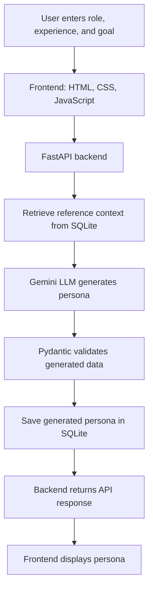
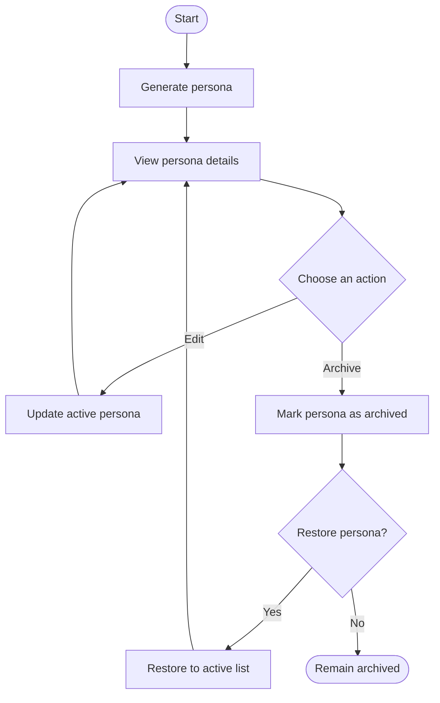

# Synthetic Figma User Persona Generator

An AI-powered application that generates and manages synthetic user personas for people who use Figma. The system uses a collected persona dataset and research-source information as reference context for an LLM to generate persona profiles.

## Application Workflow

This diagram shows how information moves through the application when a persona is generated.



## Persona Lifecycle



## Key Features

- **AI-based persona generation:** Generate synthetic personas using role, experience level, and goals.
- **Reference-data context:** Use collected persona profiles and research-source information as context for generation.
- **Persona details:** View skills, goals, preferences, challenges, and working style.
- **Persona editing:** Update details of an active persona.
- **Archive and restore:** Archive personas and restore them when needed.
- **Persistent storage:** Store persona records and reference data in SQLite.
- **API-based architecture:** Use FastAPI to connect the frontend and backend.

## Technology Stack

| Technology | Purpose |
|---|---|
| HTML, CSS, JavaScript | Frontend interface and interactions |
| FastAPI | Backend API and request handling |
| Gemini LLM | Synthetic persona generation |
| Pydantic | Validation of generated persona data |
| SQLite | Persona storage and reference datasets |
| Python | Backend implementation |

## Project Structure

```text
synthetic-user-platform/
├── app/
│   ├── main.py
│   ├── database/
│   │   ├── connection.py
│   │   ├── import_csv.py
│   │   └── repository.py
│   ├── models/
│   │   └── persona.py
│   ├── schemas/
│   │   └── persona_schema.py
│   └── services/
│       ├── persona_generator.py
│       └── persona_service.py
├── data/
│   ├── persona_profiles.csv
│   ├── research_sources.csv
│   ├── validate_datasets.py
│   └── README.md
├── frontend/
│   ├── index.html
│   ├── style.css
│   └── app.js
├── tests/
├── .env
├── .gitignore
├── requirements.txt
└── README.md
```

## Setup and Run Locally

### Requirements

- Python 3.11 recommended
- Gemini API key
- Packages listed in `requirements.txt`

### 1. Create and activate a virtual environment

Run in PowerShell:

```powershell
cd F:\synthetic-user-platform
py -3.11 -m venv .venv
.\.venv\Scripts\Activate.ps1
```

### 2. Install dependencies

```powershell
python -m pip install -r requirements.txt
```

### 3. Configure environment variables

Create a `.env` file in the project root:

```env
GEMINI_API_KEYS=your_gemini_api_key
GEMINI_MODEL=your_configured_gemini_model
```

Use a model name supported by your Gemini API account. Do not commit `.env` or publish API keys.

### 4. Start the backend

From the project root:

```powershell
python -m uvicorn app.main:app --reload
```

- Backend: `http://127.0.0.1:8000`
- Interactive API docs: `http://127.0.0.1:8000/docs`

### 5. Start the frontend

Open a second PowerShell terminal:

```powershell
cd F:\synthetic-user-platform\frontend
python -m http.server 5500
```

Open `http://localhost:5500` in your browser. Use the HTTP server instead of opening `index.html` directly.

## API Endpoints

Confirm the exact routes in `app/main.py` if your implementation changes.

| Method | Endpoint | Purpose |
|---|---|---|
| `GET` | `/health` | Check backend health |
| `GET` | `/api/personas` | List personas |
| `POST` | `/api/personas/generate` | Generate a persona |
| `GET` | `/api/personas/{persona_id}` | Retrieve a persona |
| `PATCH` | `/api/personas/{persona_id}` | Update a persona |
| `PATCH` | `/api/personas/{persona_id}/archive` | Archive a persona |
| `PATCH` | `/api/personas/{persona_id}/restore` | Restore an archived persona |

## Data Files

- `data/persona_profiles.csv` — synthetic persona-profile reference data.
- `data/research_sources.csv` — research-source records used to provide context.
- `data/validate_datasets.py` — dataset validation script.

The datasets provide reference context. Do not describe them as real-user interview data unless they were actually collected from real users. Before re-importing CSV files, check `app/database/import_csv.py` to avoid duplicate records.

## Testing

Run automated tests from the project root:

```powershell
python -m pytest tests/ -v
```

`test_gemini.py`, if present, is an optional standalone test that may make a live API request and use API quota.

## Limitations

- Personas are synthetic AI-generated profiles, not verified representations of actual Figma users.
- Output quality depends on the reference data and LLM response.

## Future Enhancements
- Add persona export options.
- Explore persona-based usability feedback as a clearly labeled experimental feature.

## Project Summary

This project demonstrates an end-to-end workflow for generating and managing synthetic Figma user personas using a frontend, FastAPI, an LLM, Pydantic validation, and SQLite persistence.
